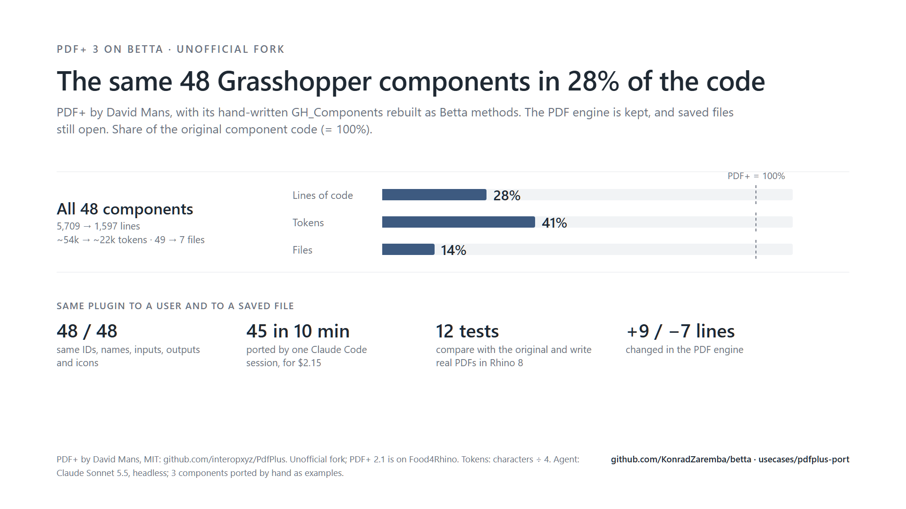

# PDF+ 3 on Betta



An unofficial fork of [PDF+](https://github.com/interopxyz/PdfPlus) by David Mans. PDF+ 3 is the PDF+ 2.1 engine with its 48 Grasshopper components written as plain C# methods, which [Betta](https://github.com/KonradZaremba/betta) turns into components when Grasshopper loads. The hand-written `GH_Component`s are gone, and with them the Rhino 6 and 7 build: PDF+ 3 needs Rhino 8 and Betta 0.8.

Definitions saved with PDF+ 2.1 open in PDF+ 3. Every component keeps its ID, name, nickname, toolbar place, inputs and outputs in order, and icon. For the official PDF+, install it from [Food4Rhino](https://www.food4rhino.com/en/app/pdf).

How the port was made and measured: [the use case write-up in the Betta repo](https://github.com/KonradZaremba/betta/blob/main/usecases/pdfplus-port/README.md). Branch `betta-port` keeps the 2.1 components next to the port, for comparison.

## What changed from PDF+ 2.1

- **Rhino 8 only, through Betta.** PDF+ 3 is a Betta plugin DLL for .NET 7, not a `.gha`.
- **The components are 7 C# files instead of 49:** 1,597 lines instead of 5,709.
- **PDFsharp and MigraDoc come from nuget.org** (1.51) instead of a custom build. The published PDFsharp has no chart frame background, so chart blocks paint the same rectangle behind the chart.
- Optional inputs that PDF+ 2.1 applied "only if wired" now have a default that means "not set": NaN, −1, empty, or an invalid rectangle. Document Permissions defaults to allowing everything.
- Several integer inputs no longer have a dropdown of named values (layout mode, units and so on). They take the same numbers as before.
- Page Boundaries no longer draws its coloured art, bleed, crop and trim boxes.
- Fast Table Block and Quick Data Set always use the first data set, not one per solve iteration.
- Set Font, Set Font Preset, Set Graphics and Set Paragraph Format output an untyped element, since they take any PDF+ element.
- Fixed: the Set components no longer fail on input that isn't a PDF+ element, and the dash pattern output is text.
- Kept as in 2.1: two components named "Document Password" (the options component reuses the name), and an Optional Password input that does nothing.

## Layout

| Path | What it is |
|---|---|
| `Components/Documents.cs`, `Pages.cs`, `Blocks.cs`, `Shapes.cs`, `Formats.cs` | The 48 components, one `[GrasshopperMethod]` each, grouped by the toolbar panels (Doc, Page, Block, Shape, Format) |
| `Wires.cs` | PDF+ objects as typed wires (`IBettaValue`), their preview and bake (`IBettaPreview`, `IBettaBakeable`), `Wire.Goo`, and the code-page setup .NET 7 needs |
| `PreviewDraw.cs` | The drawing and baking code of the 2.1 base component `GH_Pdf__Base`, made static |
| `Engine/` | The PDF+ 2.1 engine (`Classes/`, `Utilities/`). Changes since upstream: `partial` on six classes and the chart background line (+9/−7 lines) |
| `Icons/` | The PDF+ icons, embedded and matched by each method's `IconResource` |

## Build

```bash
dotnet build PdfPlus.sln -c Release
```

Targets Rhino 8 (`net7.0-windows`). PDFsharp and MigraDoc come from nuget.org (`PDFsharp-MigraDoc-gdi` 1.51.5185-beta, `MigraDoc.Extensions` 1.0.1).

## Install

1. Install Betta 0.8 or later in Rhino 8 (Package Manager, search "Betta").
2. Copy these files from `PdfPlus.Betta/bin/Release/net7.0-windows/` into `%AppData%\Grasshopper\Libraries\Betta\`, with `PdfPlus.Betta.dll` last (Betta loads a plugin the moment it appears, so its libraries must already be there):
   `HtmlAgilityPack.dll`, `MarkdownSharp.dll`, `MigraDoc.DocumentObjectModel-gdi.dll`, `MigraDoc.Extensions.dll`, `MigraDoc.Extensions.Html.dll`, `MigraDoc.Extensions.Markdown.dll`, `MigraDoc.Rendering-gdi.dll`, `MigraDoc.RtfRendering-gdi.dll`, `PdfSharp-gdi.dll`, `PdfSharp.Charting-gdi.dll`, `PdfPlus.Betta.dll`.

Uninstall PDF+ 2.1 first: both publish the same component IDs.

## Test

```bash
dotnet test PdfPlus.sln
```

12 tests; Rhino 8 must be installed (set `RHINO8_SYSTEM_DIR` if it isn't in `C:\Program Files\Rhino 8\System`).

- `PortContractTests` check that Betta publishes the same 48 components as PDF+ 2.1: IDs, names, nicknames, tab and panel, inputs and outputs in order, and icons. The 2.1 side is `PdfPlus.Betta.Tests/original-contract.json`, read from the 2.1 components' source before they were removed.
- `PdfOutputTests` start Rhino 8's core in the test process (no window, a headless document), call the component methods, save PDFs and read them back with PDFsharp: text, page sizes, metadata, password, Rhino curves and text shapes, the Save toggle, and plain values versus Grasshopper goo as inputs.

Not covered: the Grasshopper canvas (wiring by hand, viewport preview, bake).

## License

MIT, as PDF+. The engine and icons are David Mans' work; the fork adds the files in `PdfPlus.Betta` (outside `Engine/` and `Icons/`) and `PdfPlus.Betta.Tests`.
