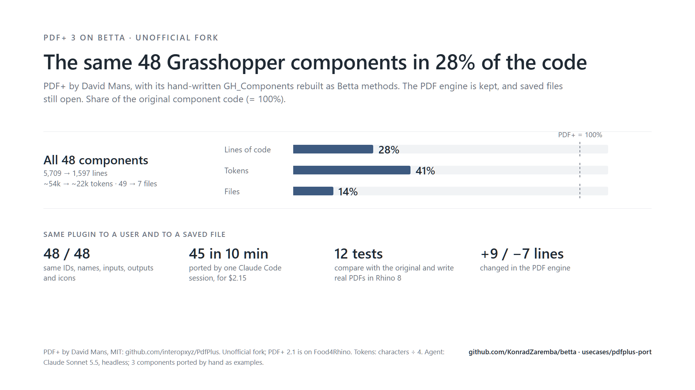

# PDF +
PDF composition plugin for Grasshopper 3d

> **This fork is PDF+ 3 on [Betta](https://github.com/KonradZaremba/betta)**, unofficial: the PDF+ 2.1 engine with its 48 components rebuilt as plain C# methods, for Rhino 8. Definitions saved with PDF+ 2.1 still open. How to build, install and test it, and what changed: [PdfPlus.Betta/README.md](PdfPlus.Betta/README.md). Branch `betta-port` keeps the 2.1 components next to the port. Everything below the picture is the original PDF+ README.
>
> 

_Like PDF+ [Buy me a coffee :D](http://www.buymeacoffee.com/davidmans)_

---

PDF Plus is a simple plugin for Grasshopper 3d that lets you compose geometry, images, and text into multi-page documents and write them to PDF files.

[Download Plugin at Food4Rhino](https://www.food4rhino.com/en/app/pdf)

## Learn More

[Plugin Documentation](https://interopxyz.gitbook.io/pdf-plus/)

### Dependencies
 - [Rhinoceros 3d](https://www.rhino3d.com/)
 - [Rhinocommon](https://www.nuget.org/packages/RhinoCommon/5.12.50810.13095)
 - [Migra Doc](https://www.nuget.org/packages/PDFsharp-MigraDoc/)
 - [Migra Doc Extensions](https://github.com/benfoster/MigraDoc.Extensions)

PDF+ is built on top of a custom build of [PDF Sharp](http://www.pdfsharp.net/).
 - [PDF Plus Fork of PDF Sharp](https://github.com/interopxyz/PDFsharp/tree/PDFplus)
 - [Pdf Sharp & Migra Doc custom build ZIP File](https://github.com/interopxyz/PdfPlus/wiki/Dependencies)

### Contributors & Forks
Special thanks to the following contributors who have improved PDF Plus and built on top of it!
- [Mathias Sønderskov Schaltz](https://github.com/Sonderwoods)
- [PDF Rex](https://github.com/PdfRex/PdfPlus)
- [Alexander Schiftner](https://github.com/snabela)
